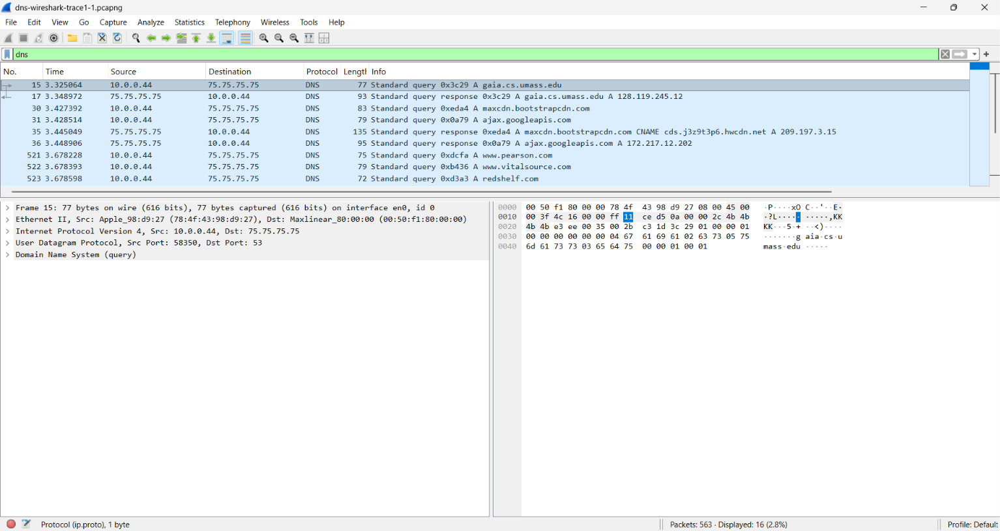
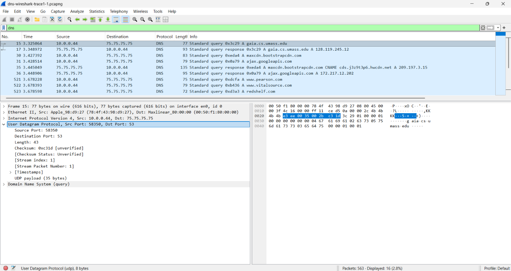
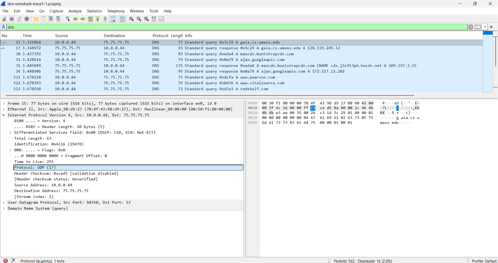
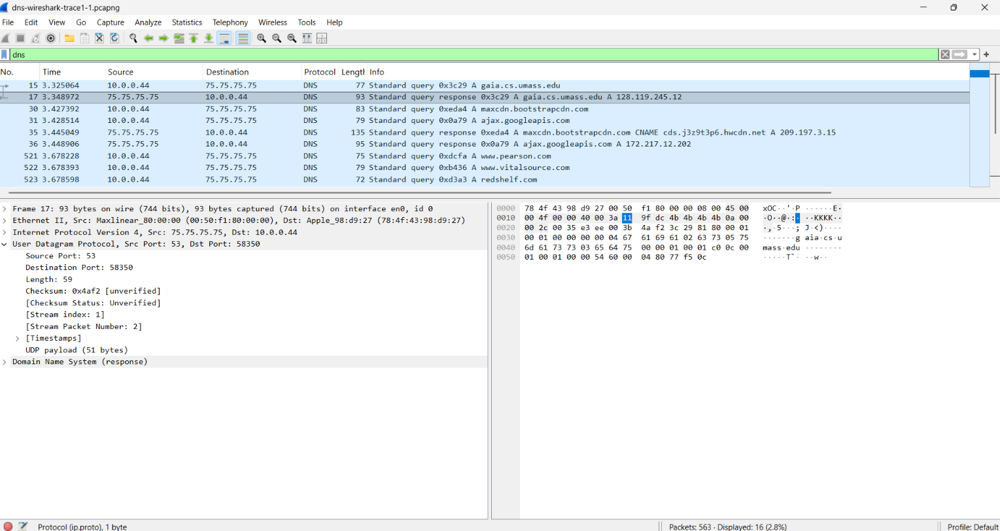

# Wireshark UDP Analysis

## Overview

This lab analyzes UDP traffic using Wireshark and the provided packet trace. The analysis focuses on identifying a UDP segment carrying DNS traffic, examining the structure and size of the UDP header fields, identifying the UDP protocol number in IPv4, and comparing source and destination ports in a UDP request/reply exchange.

## Objectives

- Identify a UDP segment in a Wireshark trace.
- Determine the application-layer protocol carried by UDP.
- Examine the four UDP header fields and their sizes.
- Interpret the UDP Length field.
- Determine the maximum UDP port value and approximate segment size.
- Identify UDP's protocol number in the IPv4 header.
- Analyze the relationship between source and destination ports in a UDP request/reply pair.

## Tools and Trace

- **Wireshark** was used to inspect and analyze packet contents.
- **Trace file:** `dns-wireshark-trace1-1`
- The trace contains DNS query and response messages carried over UDP.
- Packet **15** was selected as the first UDP segment analyzed in detail.

## UDP Packet Identification

The first UDP segment selected for analysis is **Packet 15**. Wireshark identifies the application-layer payload as a **DNS query** for `gaia.cs.umass.edu`.

The packet uses the following addressing information:

- **Source IP:** `10.0.0.44`
- **Destination IP:** `75.75.75.75`
- **UDP Source Port:** `58350`
- **UDP Destination Port:** `53`
- **Application-Layer Protocol:** DNS

The destination port `53` corresponds to DNS traffic, which is consistent with the DNS query shown in Wireshark.

## UDP Header Structure

The UDP header contains **four fields**:

1. **Source Port**
2. **Destination Port**
3. **Length**
4. **Checksum**

Each field is **2 bytes (16 bits)** long, making the total UDP header size **8 bytes**.

For Packet 15, Wireshark shows:

- **Source Port:** `58350`
- **Destination Port:** `53`
- **Length:** `43 bytes`
- **Checksum:** present in the UDP header

The UDP **Length** field represents the total size of the UDP datagram, including both the **8-byte UDP header** and the UDP payload.

## UDP Limits and Protocol Number

Because the UDP **Length** field is 16 bits wide, the total UDP datagram size can be approximately `2^16` bytes.

The UDP source and destination port fields are also 16 bits wide, so the largest possible port number is:

`2^16 - 1 = 65,535`

The IPv4 header identifies UDP using protocol number:

`17`

Wireshark confirms this in Packet 15 with:

`Protocol: UDP (17)`

## DNS Request/Reply Port Analysis

The UDP request/reply pair analyzed in the trace consists of:

### Request — Packet 15

- **Source IP:** `10.0.0.44`
- **Destination IP:** `75.75.75.75`
- **Source Port:** `58350`
- **Destination Port:** `53`

### Reply — Packet 17

- **Source IP:** `75.75.75.75`
- **Destination IP:** `10.0.0.44`
- **Source Port:** `53`
- **Destination Port:** `58350`

The source and destination port numbers are reversed in the reply:

`Request: 58350 → 53`

`Reply: 53 → 58350`

This shows that the reply is sent from the server's port back to the temporary source port used by the requesting host.

